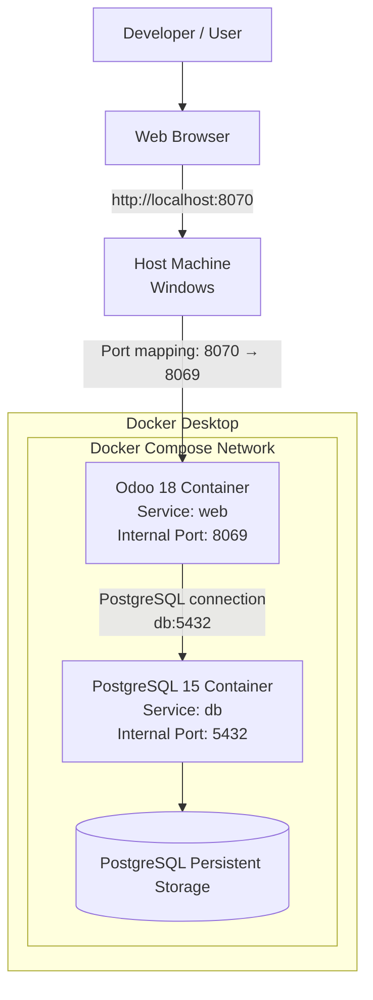
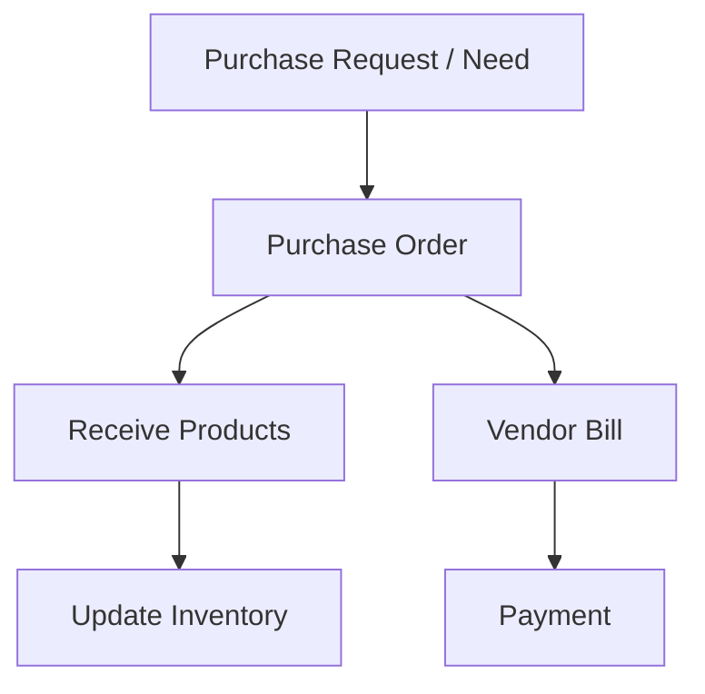
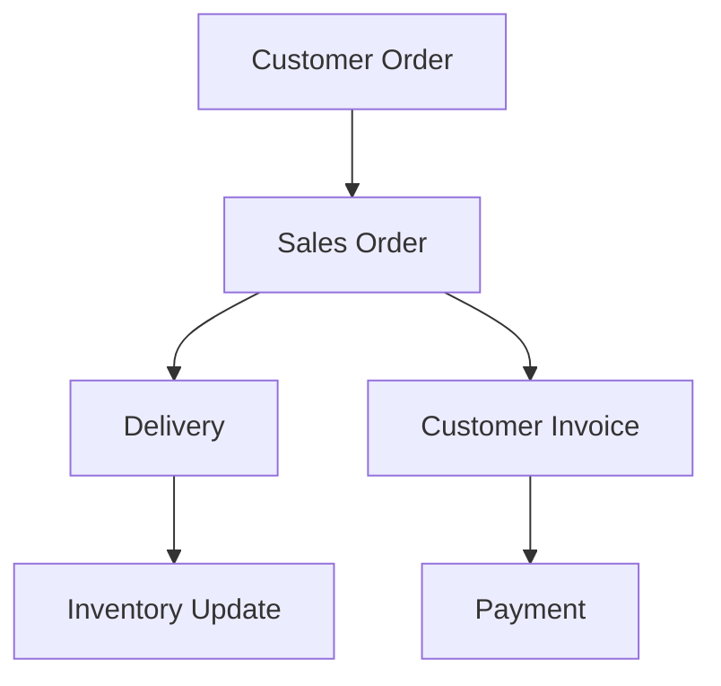

<div align="center">

# 🏢 Odoo 18 ERP — Dockerized Environment

**A reproducible, containerized ERP foundation built with Odoo 18, PostgreSQL 15 and Docker Compose.**

[](https://www.odoo.com/)
[](https://docs.docker.com/compose/)
[](https://www.postgresql.org/)
[](https://www.python.org/)

[Overview](#-overview) •
[Architecture](#-architecture) •
[Quick Start](#-quick-start) •
[Challenges Solved](#-technical-challenges--solutions) •
[Roadmap](#-roadmap)

</div>

---

## 📌 Overview

Business operations such as purchasing, sales, inventory and accounting are often handled in disconnected tools or manual processes. The result is duplicated data, inconsistent records, limited visibility and slow coordination between departments.

**This project sets up the infrastructure for solving that problem with an ERP.** It deploys **Odoo 18** and **PostgreSQL 15** as two separate containers orchestrated by **Docker Compose**, giving a clean, isolated and easy-to-manage base on which Odoo's modular business applications can run.

Rather than installing Odoo directly on the host OS, every service runs in its own container. This simplifies service management, makes the environment easy to restart or rebuild, and provides a solid starting point for future customization and module development.

> **Project type:** Academic ERP implementation mini-project &nbsp;|&nbsp; **Host environment:** Windows + Docker Desktop

### 🎯 What this project demonstrates

| Area | Skills shown |
|---|---|
| **ERP** | Odoo architecture, modular business applications, module management |
| **Containerization** | Docker, multi-container orchestration with Docker Compose |
| **Databases** | PostgreSQL integration, database initialization, direct SQL verification |
| **Configuration** | Externalized Odoo configuration (`odoo.conf`), port mapping, service discovery |
| **Troubleshooting** | Diagnosing config, mount-path, networking and port-conflict issues (see [below](#-technical-challenges--solutions)) |

---

## ✨ Key Features

- 🐳 **Two-container architecture** — Odoo (`web`) and PostgreSQL (`db`) run as separate, isolated services.
- ⚙️ **One-command startup** — the whole environment is managed with `docker compose up -d`.
- 🔗 **Service-name networking** — Odoo reaches PostgreSQL via `db:5432` on the internal Compose network, with no database port exposed to the host.
- 🔧 **Externalized configuration** — server and database settings live in `config/odoo.conf`.
- 🔀 **Conflict-free port mapping** — host port `8070` maps to Odoo's internal `8069`.
- 💾 **Persistent storage** — Docker volumes keep database data across container restarts.
- 🔍 **Database-level verification** — module installation state checked directly in PostgreSQL (`ir_module_module`).

---

## 🧰 Tech Stack

| Technology | Version | Role |
|---|---|---|
| **Odoo** | 18.0 (`odoo:18.0` image) | ERP application platform |
| **PostgreSQL** | 15 (`postgres:15` image) | Relational database / persistent storage |
| **Docker** | Docker Desktop | Container runtime |
| **Docker Compose** | Compose | Multi-container orchestration |
| **Python** | Odoo runtime | Odoo's backend language (basis for future custom modules) |
| **XML** | Odoo ecosystem | Odoo configuration and module data |
| **Git** | — | Version control |
| **Windows** | — | Development / host environment |

<details>
<summary><b>Why these technologies?</b></summary>

- **Odoo 18** — provides the ERP framework, business applications, database management and modular architecture.
- **Docker** — encapsulates dependencies and provides isolated execution environments.
- **Docker Compose** — defines and orchestrates the Odoo and PostgreSQL services from a single configuration.
- **PostgreSQL 15** — persistent relational storage for business records, application settings and module information.
- **Python** — Odoo's backend is built primarily in Python, making it the main language for future module development.

</details>

---

## 🏗 Architecture

The deployment follows a **two-service architecture**. Both containers communicate over the internal Docker Compose network, and only Odoo is exposed to the host.



### Services

| Component | Compose service | Internal port | Responsibility |
|---|---|---:|---|
| Odoo | `web` | 8069 | ERP application |
| PostgreSQL | `db` | 5432 | Database management |

### Design decisions

| Decision | Rationale |
|---|---|
| Use `db` as `db_host` instead of `localhost` | Containers resolve each other by **service name** inside the Compose network. |
| Map host port `8070` → container `8069` | Host port `8069` was already in use; only the host side changed, so Odoo's internal port stays default. |
| Do not publish the PostgreSQL port | Odoo-to-database traffic stays on the internal network; no public DB port is needed. |
| Move settings into `odoo.conf` | The `--admin-passwd` CLI argument did not work in the chosen startup setup; a config file is also easier to manage. |

---

## 🧩 ERP Modules & Business Workflows

The project uses **standard Odoo applications** — no custom-developed modules are claimed.

| Module | Technical name | Business domain | Status |
|---|---|---|---|
| Accounting / Invoicing | `account` | Financial documents and accounting | ✅ Installed state verified in PostgreSQL |
| Sales | `sale_management` | Sales management | 🔲 In scope — verify in Odoo Apps |
| Purchase | `purchase` | Procurement | 🔲 In scope — verify in Odoo Apps |
| Inventory | `stock` | Warehouse and stock management | 🔲 In scope — verify in Odoo Apps |

### Target workflows

These diagrams show the **intended standard Odoo flows** these modules enable. They have **not** been configured and tested end-to-end in this project yet.

<table>
<tr>
<td width="50%" valign="top">

**Procure-to-Pay (P2P)**



</td>
<td width="50%" valign="top">

**Order-to-Cash (O2C)**



</td>
</tr>
</table>

---

## 🚀 Quick Start

### Prerequisites

- [Docker Desktop](https://www.docker.com/products/docker-desktop/) (includes Docker Compose)
- [Git](https://git-scm.com/)
- A modern web browser

```bash
docker --version
docker compose version
docker info          # confirms the Docker daemon is running
```

### 1. Clone the repository

```bash
git clone https://github.com/YOUR_USERNAME/YOUR_REPOSITORY.git
cd YOUR_REPOSITORY
```

### 2. Configure

Reference deployment values:

| Setting | Value |
|---|---|
| Odoo image | `odoo:18.0` |
| PostgreSQL image | `postgres:15` |
| Odoo host port → container port | `8070` → `8069` |
| PostgreSQL internal port | `5432` |
| Database name | `miniprojet_erp18` |

Review `docker-compose.yml` and `config/odoo.conf`, and set **your own** PostgreSQL credentials and Odoo master password.

> [!WARNING]
> Never commit real passwords or credentials to a public repository.

### 3. Start the environment

```bash
docker compose up -d
docker compose ps              # check service status
docker compose logs -f web     # follow Odoo logs
```

### 4. Open Odoo

👉 **http://localhost:8070**

On first launch, create a database (name, administrator credentials, and the master password from `odoo.conf`) or select the existing one. If the PostgreSQL data volume is preserved, Odoo reconnects to the existing database after a restart.

### 5. Stop the environment

```bash
docker compose stop     # stop services, keep containers
docker compose down     # stop and remove containers (named volumes are kept)
```

> [!CAUTION]
> `docker compose down -v` also deletes named volumes and **destroys the database data**. Use it only when you intentionally want to reset the environment.

---

## 🛠 Usage

### Useful commands

| Command | Description |
|---|---|
| `docker compose up -d` | Start services |
| `docker compose down` | Stop and remove containers |
| `docker compose stop` | Stop services without removing containers |
| `docker compose restart` | Restart services |
| `docker compose ps` | Display service status |
| `docker compose logs -f` | Follow all logs |
| `docker compose logs -f web` | Follow Odoo logs |
| `docker compose logs -f db` | Follow PostgreSQL logs |
| `docker compose exec web bash` | Open a shell in the Odoo container |
| `docker compose exec db bash` | Open a shell in the PostgreSQL container |

### Verifying modules directly in PostgreSQL

Open a `psql` session inside the database container:

```bash
docker compose exec db psql -U YOUR_POSTGRES_USER -d miniprojet_erp18
```

List all installed modules:

```sql
SELECT name, state
FROM ir_module_module
WHERE state = 'installed'
ORDER BY name;
```

Check a specific module (this is how the Accounting module was verified):

```sql
SELECT name, state
FROM ir_module_module
WHERE name = 'account';
```

---

## ✅ Results & Current Status

Honest scope, clearly separated into confirmed and not-yet-done:

| Item | Status |
|---|---|
| Odoo 18 deployed via the official Docker image | ✅ Done |
| PostgreSQL 15 integrated in a separate container | ✅ Done |
| Docker Compose orchestration of both services | ✅ Done |
| Database `miniprojet_erp18` created and connected | ✅ Done |
| Accounting module installed state verified in PostgreSQL | ✅ Done |
| Sales / Purchase / Inventory installation confirmed | 🔲 To verify in Odoo Apps |
| End-to-end P2P / O2C workflow testing | 🔲 Not yet documented |
| Custom Odoo modules | 🔲 Not part of current scope |

---

## 🧠 Technical Challenges & Solutions

| # | Challenge | Solution | Takeaway |
|---|---|---|---|
| 1 | The `--admin-passwd` CLI argument did not work in the chosen Odoo startup configuration. | Moved settings into a dedicated `odoo.conf` file. | Config files give a cleaner way to manage server and database settings. |
| 2 | Two independent services (Odoo + PostgreSQL) had to run together. | Defined both in a single Docker Compose deployment. | One set of commands manages the entire stack. |
| 3 | Odoo had to reach PostgreSQL in a container, not a database on the host. | Set `db_host = db` and `db_port = 5432`. | Compose service names act as internal hostnames. |
| 4 | Host port `8069` was already occupied. | Mapped `"8070:8069"`. | Only the host side changes; Odoo's internal port is untouched. |
| 5 | Odoo needed an initialized database before apps could be used. | Created `miniprojet_erp18`, confirmed Odoo connected, then checked module state in PostgreSQL. | Verify at the data layer, not just in the UI. |
| 6 | `odoo.conf` was accidentally created as a **directory** instead of a file. | Corrected the path so Odoo reads a real file. | Always check file types and mount paths in Docker volume mappings. |

---

## ⚙️ Configuration

### Docker Compose (architectural outline)

```yaml
services:

  db:
    image: postgres:15
    # PostgreSQL environment and storage
    # are configured here.

  web:
    image: odoo:18.0
    depends_on:
      - db
    ports:
      - "8070:8069"
    # Odoo configuration and storage
    # are configured here.
```

> This is a simplified outline, not a replacement for the real file. The full configuration must keep your database credentials, volume declarations, configuration mounts and environment variables.

### `config/odoo.conf`

```ini
[options]

; Database connection
db_host = db
db_port = 5432
db_user = YOUR_POSTGRES_USER
db_password = YOUR_POSTGRES_PASSWORD

; Odoo master password
admin_passwd = YOUR_MASTER_PASSWORD
```

The two passwords serve different purposes:

| Setting | Purpose |
|---|---|
| `db_password` | Authenticates Odoo against PostgreSQL. |
| `admin_passwd` | Protects database administration operations in Odoo. |

Credentials must match the PostgreSQL settings in `docker-compose.yml`.

---

## 📁 Project Structure

```text
odoo-18-erp-mini-project/
├── docker-compose.yml     # Odoo + PostgreSQL services, networking, ports, storage
├── config/
│   └── odoo.conf          # Odoo server and database connection settings
├── .gitignore             # Excludes local files, credentials, generated files
└── README.md              # Project documentation
```

> This is the documented target layout. Verify it against the actual repository, particularly the locations of `odoo.conf` and `docker-compose.yml`.

---

## 🗺 Roadmap

Planned enhancements — **not** features claimed as implemented.

| Improvement | Description | Priority |
|---|---|---|
| Custom Odoo modules | Develop Python modules for organization-specific requirements | 🔴 High |
| NIF validation | Custom validation for Algerian fiscal identification information | 🔴 High |
| Purchase workflow | Configure and test a complete procure-to-pay process | 🔴 High |
| Sales workflow | Configure and test the order-to-cash process | 🔴 High |
| Security hardening | Use environment variables or secrets for credentials; restrict database exposure | 🔴 High |
| Inventory management | Configure warehouses, stock operations and product tracking | 🟡 Medium |
| Automated testing | Tests for custom models, business logic and workflows | 🟡 Medium |
| CI/CD | Automate validation and deployment with GitHub Actions | 🟡 Medium |
| Production deployment | Production-oriented configuration with HTTPS | 🟡 Medium |
| Monitoring & backups | Database backups, health checks and service monitoring | 🟡 Medium |

<details>
<summary><b>Custom module development — possible directions</b></summary>

Building on Odoo's ORM, model architecture, security mechanisms and module system, potential extensions include:

- Additional business models
- Custom fields and validation rules
- Automated business operations
- Custom views and menus
- Integration with existing Odoo applications

</details>

---

## 📝 Technical Notes & Limitations

- This is an **Odoo 18** implementation, not the earlier Odoo 15 training exercise.
- It uses the official Odoo Docker image, with PostgreSQL 15 in a separate container.
- Host access is via port `8070`, mapped to Odoo's internal port `8069`.
- No custom Odoo modules are claimed in the current implementation.
- Complete end-to-end business workflow testing has not been documented.
- Volume names, credentials strategy, configuration mount paths and module installation states should be verified in the final repository before being treated as definitive.

---

## 👤 Author

**[Your Full Name]**
Software Engineering Student · ERP & Backend Development Enthusiast

Interests: ERP · Odoo Development · Backend Engineering · Python · Database Systems · Docker & Containerization

[](https://github.com/YOUR_USERNAME)

---

<div align="center">

**Odoo 18 ERP Mini-Project** — built with Odoo, PostgreSQL and Docker Compose.

</div>
